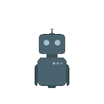

 

## About Me

AI Engineer at **Labh Enterprise** in Surat, building AI-first products from zero to production. I currently work on **visual search** and **conversational AI** systems for a textile-tech business.

I started from a tier-3 college and taught myself open source, real-world projects and industry AI skills. My work sits where applied machine learning meets real engineering: turning ideas like embeddings and retrieval into systems that actually ship.

I care about moving fast in small teams and building things that hold up in production. Always glad to connect with founders, fellow engineers, or anyone just starting out.

 

## Open Source

- **[OpenCV](https://github.com/opencv/opencv)**: contributor with merged pull requests
- **[Restaurant Feedback AI](https://github.com/kazisufiyan-k2/restaurant-feedback-ai)**: open-source review analysis model for sentiment, aspects and emotions, with suggested replies. Macro F1 of 0.697 vs 0.513 for a VADER-only baseline
  - [Live demo](https://huggingface.co/spaces/Sufiyank02/restaurant-feedback-ai) · [Model on Hugging Face](https://huggingface.co/Sufiyank02/restaurant-feedback-model)

 

## Areas of Depth

### Vector Search & Retrieval
Benchmarked Pinecone, Milvus, ChromaDB and pgvector on latency, recall and indexing trade-offs, including HNSW dimensionality limits.

### Embedding Systems
Built multimodal embedding pipelines for image and text retrieval, powering a production visual search system.

### Cloud AI Infrastructure
Vertex AI, Cloud Run, IAM authentication patterns, signed URL delivery and Cloud Build CI/CD.

### Production API Engineering
FastAPI backends with authentication, CORS handling, connection pooling and containerized deployment.

### Automation & Agentic Systems
AI chatbot automation for customer engagement, multi-agent workflows with LangGraph, and RAG pipelines.

### Machine Learning & NLP
Classical ML and NLP models trained, evaluated against baselines and published with honest model cards.

 

## 🛠️ Tech Stack

**AI / ML & Generative AI**
 

**Backend & Databases**
 

**Cloud, DevOps & Tools**
 

 

## 🔬 Currently Building & Exploring

- A multi-agent AI hiring platform that evaluates candidates by proof of work, not just resumes
- RAG and multi-agent AI systems in production
- Cloud-native ML infrastructure at scale
- Hackathons, where I build and ship working AI products fast

 

## 🏆 Certifications

 

 

## 🎓 Education

**B.E., Computer Science & Engineering**
 
S.N. Patel Institute of Technology & Research Centre, Gujarat Technological University · 2022–2026

 

